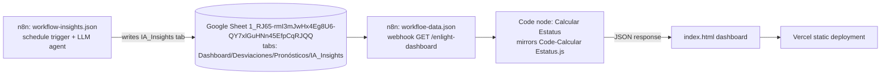

# CLAUDE.md — Enlight One Dashboard

## Purpose
Interactive project dashboard for monitoring photovoltaic and BESS projects across all phases and PMs. Consumes data from a Google Sheet ("Enlight One Database_Esquema 2026") via an n8n webhook and deploys to Vercel as a static site. Companion tool to the Enlight One PM milestone tracker system.

## Status
- **Phase:** Active Development
- **Last audited:** 2026-10-26 (ADR #11 verified live in n8n; "vs plan" clarity pass; redesign prototype audited). Previous: 2026-10-09 (impeccable audit + polish over all 4 tabs).
- **Last modified:** 2026-10-26 — pushed `88d8fbf` (`index.html`: hito deviation shown "vs plan" + layout fixes, ADR #15). Still **uncommitted** (docs/config only): `Code-Calcular Estatus.js` / `workfloe-data.json` (ADR #11 — already live in n8n, only the local copies lag git), `Guia_Estrategica_Indicadores_Enlight_One.md`, `DESIGN.md`, `colors_and_type.css`, `prototipo-vistas.html` (not deployed, see Open Questions), `.impeccable/`. See Audit Refresh 2026-10-26 below.
- **Owner:** Emiliano / Enlight TECH

## Architecture

- `workflow-insights.json` runs on a schedule, reads Dashboard/Desviaciones, calls a Gemini LLM agent (`@n8n/n8n-nodes-langchain`), and writes rows back into the `IA_Insights` tab. `workfloe-data.json` later reads that tab and returns the latest-timestamp batch to the dashboard as `insightsIA`.
- The `Pronósticos` tab implements a forecast cascade (Real > Modificada > Tentativa > Prevista per hito) and stamps unfinished hitos with `Fecha Real` = today, which is why the deviations logic must split "closed" vs "open (in-progress)" measurements (see Key Technical Decisions).

## Files & Responsibilities
| File | Type | Purpose |
|------|------|---------|
| `index.html` | HTML | Main, actively-deployed dashboard (~2,910 lines) — dark/light theme, Chart.js visualizations, multi-tab, Gantt view, filters, login gate |
| `fonts/` | Assets | Self-hosted variable fonts from the Enlight DS (`Alexandria-VariableFont_wght.ttf`, `AlbertSans-VariableFont_wght.ttf`, ~450 KB), loaded via `@font-face` in `index.html`. **Must be deployed with `index.html`** or the UI falls back to the system font. |
| `DESIGN.md` | Docs | Copy of the canonical Enlight design authority (`~/.claude/enlight-design-system/DESIGN.md`) so `/impeccable` refines within the DS. Not needed at runtime. |
| `Dashboard Enlight.dc.html` | HTML | Separate/older version (580 lines vs ~2,910 in index.html — **not** a near-duplicate; diverged significantly). Deployment target unclear. |
| `Code-Calcular Estatus.js` | n8n Code node JS | Source-of-truth copy of the "Calcular Estatus" Code node. **Verified byte-identical** (CRLF-normalized) to the `jsCode` embedded in `workfloe-data.json` as of 2026-07-08 — keep both in sync manually whenever one is edited; there is no build step that syncs them automatically. |
| `workfloe-data.json` | n8n workflow | Main data-fetch flow: Webhook → 3x Google Sheets reads (Dashboard, Desviaciones, Pronósticos) + 1 metadata read (Fecha pronóstico) + IA_Insights read → Merge → Code (Calcular Estatus) → Respond to Webhook. Filename has a typo (missing "r"). |
| `workflow-insights.json` | n8n workflow | Schedule-triggered flow: reads Dashboard + Desviaciones → LangChain Agent (Gemini) → writes to IA_Insights tab. |
| `vercel.json` | Config | Minimal Vercel config (`{"framework": null}`) — static file serving, no build step |
| `README.md` | Docs | Setup instructions; **out of date** — describes a `public/index.html` + `n8n/workflow.json` folder structure that does not exist in this repo (files live at repo root) |
| `logo-enlight.png` / `logo-enlight-dark.svg` | Assets | Dashboard branding |
| `prototipo-vistas.html` | HTML (prototype) | **Not deployed, review-only.** Redesign proposal from the `dashboard-specification` session (2026-10-26): two audience views — **Dirección** (hero KPIs, empty weekly-trend placeholder, breakdowns, project table) and **Operación** ("Atención hoy" list of overdue hitos with área/comentario/On Hold, deviation charts, glossary). Same webhook and data contract as `index.html`, but a **separate re-implementation** (rules like SPI/aggDesv/OH are duplicated, not shared). No login gate, light theme only, no Gantt/Insights. Needs `colors_and_type.css`, `fonts/`, `logo-enlight-dark.svg` as siblings. |
| `colors_and_type.css` | CSS | Copy of the DS token file (`~/.claude/enlight-design-system/`), used only by the prototype; `index.html` still declares local hex vars (Known Issue #2). |
| `.impeccable/config.json` | Config | Detector ignore for `cramped-padding` scoped to `prototipo-vistas.html` (false positive on the tab underline). |

## External Dependencies
| System | How connected | Credential location |
|--------|---------------|---------------------|
| Google Sheets ("Enlight One Database_Esquema 2026", ID `1_RJ65-rmI3mJwHx4Eg8U6-QY7xlGuHNn45EfpCqRJQQ`) | n8n Google Sheets nodes — tabs: Dashboard (gid=0), Desviaciones (gid=1915245543), Pronósticos (gid=1857694411, data range A2:BB, forecast cut-date in row 1 read by the 'Fecha pronóstico' node), IA_Insights (gid=63866189) | n8n credentials store |
| n8n webhook (`egenlight.app.n8n.cloud/webhook/enlight-dashboard`) | Browser `fetch()` from `index.html` (GET, no auth) | n8n instance (self-hosted) |
| Gemini LLM (via LangChain node) | `workflow-insights.json` agent node | n8n credentials store |
| Vercel | Static deployment of `index.html` | Vercel account |
| Google OAuth (implicit flow, client-side only) | `index.html` login screen — reuses the **shared Enlight Google OAuth client** (`354309643896-...apps.googleusercontent.com`, same client Portal ICs/Formulario EPP use), `hd=enlight.mx` restriction, `id_token` parsed client-side, session cached in `localStorage` (`enlightOneDashboardUser`) | Google Cloud Console (shared client) — `https://enlightone.vercel.app` added to its Authorized redirect URIs |

## Key Technical Decisions (ADRs)
1. **SPI (Schedule Performance Index)** = `aTiempo / (aTiempo + conRetraso + atrasados)`, rounded to 2 decimals (see `calcSPI()` in `index.html`). Color-coded: ≥0.90 accent/green, ≥0.70 warn/yellow, <0.70 danger/red.
2. **13 hitos tracked per project** — confirmed: the `HITOS` array in `Code-Calcular Estatus.js` has exactly 13 entries (Entrega Ingenierías → Interconexión).
3. **Estatus logic**: reference date = Tentativa if present, else Prevista. Without a "Fecha modificada" the hito is `Atrasado` (past reference) or `Pendiente` (future reference); with one it's `Cumplido a tiempo` or `Cumplido con retraso`. The "real" columns (`Fecha <hito>`) in Dashboard are **computed cascade values, not PM input** and are intentionally not used for status — only `Fecha modificada <hito>` reflects genuine PM entry.
4. **Open vs closed deviations (added 2026-07-08)**: each row in `desviaciones` now carries a `cerrada` flag (true if the hito already has a `Fecha modificada` in Dashboard). Because the deviation sheet's cascade writes `Fecha Real` = today for unfinished hitos, an "open" deviation's day-count grows daily and would corrupt averages if mixed with real (closed) deviations. `promedioDesviacion` / `promedioDesviacionNeta` now aggregate **closed only**; a new `promedioDesviacionAbierta` output aggregates **open** deviations (measured against the original Prevista, a moving count vs today).
5. `numOrNull()` helper distinguishes a genuine blank/no-data value from a legitimate `0` in deviation fields (previous `parseFloat(x) || 0` pattern silently conflated the two).
6. Header-typo tolerance is handled in code rather than by editing the live sheet, to avoid breaking other consumers of the sheet:
   - `% ApbCliente` (sheet is missing a space) — read with a no-space fallback key.
   - `Fecha modificada Pase a Pase a Gestión` — the sheet header itself has this duplicated "Pase a" typo; code reads it and also tries `Fecha modificada Pase a Gestión` (`modificadaAlt`) so nothing breaks if the header is ever corrected.
   - Desviaciones hito name for "Pase a Servicios" corrected to `'Pase a Servicios'` (previously mismatched as `'Fecha Pase a Servicios/liberación de sitio'`, which never matched anything in the Desviaciones sheet's `Hito` column).
   - Gantt plan-date map: `'Apb Cliente'` now reads `'Fecha tentativa ingeniería aprobada por el cliente'` (the previous mapped column name did not exist in the sheet, so plan bars for the Ingeniería phase were rendering blank).
7. **Client-side re-aggregation of deviations**: `index.html`'s `aggDesvPorHito()` (added 2026-07-08) recomputes the deviation charts ("Desviación neta promedio por hito", "Desviación en curso por hito") and the "Desv. neta promedio" KPI directly from `rawData.desviaciones`, filtered by whatever filters are currently active. This makes **all charts on all tabs filter-reactive**. Falls back to the server pre-aggregates when per-row detail or the `cerrada` flag is missing (demo mode, or an older cached API payload without the field).
8. Demo mode flag (`DEMO_MODE` constant, currently `false`) and `API_URL` constant (currently `https://egenlight.app.n8n.cloud/webhook/enlight-dashboard`) are both hardcoded at the top of the `<script>` block in `index.html` — README instructs editing them directly rather than using an env var.
9. **Login gate (added 2026-09-02)**: a Google OAuth implicit-flow login screen (same pattern as "Tasks ICs" Portal ICs) now sits in front of the dashboard shell in `index.html` — `GOOGLE_CLIENT_ID`/`ALLOWED_DOMAIN`/`LS_AUTH_KEY` constants, `handleGoogleLogin()`/`parseAuthFromURL()`/`showApp()`/`logout()`/`initAuth()` functions, `#loginScreen` + `#appShell` markup. It reuses the shared Enlight Google OAuth client already authorized for `enlight.mx`; `https://enlightone.vercel.app` was added to that client's Authorized redirect URIs in Google Cloud Console. **This is a UI-only gate** — the id_token is decoded and domain-checked client-side, not verified against Google or by the n8n webhook, and `API_URL` (see Known Issues #6) remains a public, unauthenticated endpoint anyone with the URL can still call directly. It stops casual/unauthenticated browser access to the dashboard UI; it does not make the underlying data endpoint private.
10. **Expandable forecast-row detail panel (found 2026-09-03; now in `main` — pushed by the remote, commits 59e8e9c/fe8c2ea)**: rows in the Tab 3 "Fechas y Pronósticos" table are now clickable (`toggleForecastRowDetail()` / `renderForecastDetailContent()` in `index.html`), expanding to show 3 pre-cascade summary cards (Cierre Comercial, Pase a Operaciones/Estatuto, Kick Off interno) plus a full 13-hito breakdown table (Hito | Prevista | Tentativa | Modificada | Real). This is the first place in the dashboard where the Desviaciones sheet's per-hito `Fecha Real` is surfaced directly to end users (distinct from the Dashboard tab's own contaminated "real" columns — see ADR #3, which still holds for the status *calculation*, just not for this display).
11. **Per-hito deviation now sourced from Desviaciones sheet where available (found 2026-09-03; **verified LIVE 2026-10-26** — the "Calcular Estatus" node of the active workflow "Enlight One Dashboard" (`6HsjSVDl8C553Zsx`, last updated in n8n 2026-07-30) is identical, CRLF-normalized, to `Code-Calcular Estatus.js` and the `workfloe-data.json` Code node, and contains `desvByProjHito`; only the local git copies are uncommitted)**: in `Code-Calcular Estatus.js`, the `diasDesviacion` attached to each project's individual hito record (shown when expanding a project row in Tab 1, and in the new Tab 3 panel from #10) now first looks up the matching row in the Desviaciones sheet (`desvByProjHito`) — using `desviacionNeta` (OH-adjusted) for closed hitos and gross days-vs-today for open/Atrasado hitos — falling back to the old local `daysDiff()` calculation only when no matching Desviaciones row exists. This makes the per-project detail number consistent with the "neta" convention already used by the Tab 2 aggregate charts (see ADR #4).
12. **On Hold surfaced in Tab 2 cards (2026-10-09)**: the webhook always carried `diasOnHold` per Desviaciones row (157 rows / 22 projects at check time), but Tab 2 only showed the *net* figure ("sin días On Hold") so users comparing against the Sheet saw e.g. 49.0 d vs 379 d of OH and couldn't reconcile. `renderKPIs2()` in `index.html` now renders **5 cards**: the net-deviation card's subtitle reads `bruta X d − On Hold`, and a new **"Días On Hold"** card shows the total OH of the filtered projects. OH total = sum over projects of the **max** `diasOnHold` across that project's rows, because "Días On Hold Aplicables" is cumulative per hito (not additive across rows). Gross average uses the same `aggDesvPorHito('diasDesviacion', true)` aggregation as the net KPI (average of per-hito averages, closed hitos only). Example check: PROJ-561 → neta 49.0 d, bruta 208.5 d, OH 379 d.
13. **"Desviación en curso por hito" now plots NET (sin On Hold) (2026-10-09)**: for operations the actionable number is the delay not explained by pauses, so the chart uses `desviacionNeta` of open rows (all 454 open rows at check time carry a neta) with the gross figure in the tooltip. Open rows without a neta would be silently omitted (`aggDesvPorHito` skips nulls) — check the Desviaciones column if a hito disappears. The server pre-aggregate `promedioDesviacionAbierta` (gross) is now only the demo/old-payload fallback.
14. **UI polish pass, all 4 tabs (2026-10-09, `/impeccable audit` → `polish`)**: self-hosted Alexandria + Albert Sans replace Roboto/Google Fonts (`--font-body` = Albert Sans, Chart.js defaults too); 11 px floor for functional text (65 undersized-text findings → 0; canvas chart fonts floor 10 px; decorative `content:` glyphs excluded); `--text2` lightened `#828080 → #888686` to reach 4.5:1 on `--surface`; `:focus-visible` Jade ring (`0 0 0 3px rgba(0,170,133,.35)`); `prefers-reduced-motion` block; ARIA `tablist/tab/tabpanel` + arrow/Home/End keyboard nav on the tab bar; `role="img"` + `aria-label` on the two deviation charts; `font-variant-numeric: tabular-nums` on KPI values. Detector findings: 129 → 55 (see Known Issues for what remains). **Caveat:** the size bump was *not* visually verified in every tab (login gate blocks headless review) — dense areas (Gantt, account rows, fixed-column grids like the hito rows' `180px minmax(40px,1fr) 200px`) deserve a manual look after any further change.
15. **Hito deviation shown "vs plan", with status/days kept as two different measures (2026-10-26, pushed `88d8fbf`)**: a hito can read "A tiempo" and still carry red days because the **status** is computed against the *current* reference (Tentativa, else Prevista — ADR #3) while the **days** are the *net* deviation against the *original* Prevista, without On Hold (ADR #11/#4). We kept both (they answer different questions) and made it legible in the Tab 1 project detail (`renderDetailRow()`): the text reads `+47d vs plan`; it is red **only** when the status is Atrasado/Cumplido con retraso, neutral grey (`var(--ink-muted, var(--text2))`) with "A tiempo", Jade when ≤0; a `0d` is hidden (typical of a Retraso hito whose deviation On Hold absorbed fully) and left in the badge tooltip; tooltip lists Prevista · Tentativa · Modificada. The Tab 3 forecast panel (`renderForecastDetailContent()`) applies the same rule to Modificada/Real date colors via `desvDateColor(dias, estatus)`. Layout fixes in the same commit: the hito row status column is a **fixed 200px** (per-row `max-content` made bars uneven because each row is its own grid), `.detail-grid` is `1.7fr 1fr` with a 24px gap, and `.detail-content` is anchored to the visible width (`position:sticky; left:0; width:100cqw`, with `.table-scroll{container-type:inline-size}`) so the info panel stays visible while the 15-column table scrolls horizontally. Per-hito On Hold is **not** in the hito record (only in Desviaciones rows), so the tooltip does not show it. `--ink-muted` is not defined in `index.html`'s local vars; the fallback to `--text2` applies.

## Design System Compliance
- Fonts: **Alexandria + Albert Sans, self-hosted from `fonts/`** (fixed 2026-10-09; no more Roboto / Google Fonts). Body/UI text uses Albert Sans; Alexandria for display/headings/KPI values.
- Colors match brand palette (`--c1:#293C47`, `--c2:#00AA85`, `--c3:#3D7D80`, `--c4:#121926`, `--c5:#828080` = Acero/Jade/Cerceta/Marino/Gris) but are hardcoded hex as local CSS vars, not imported from `colors_and_type.css`. `--text2` is now `#888686` (a ~3% lightened Gris, for contrast). Several hex literals are also inlined directly in markup/JS (e.g. Gantt legend spans, `ADO_COLORS`), bypassing the var layer. Non-brand semantic colors remain: `#9f7aff` (SPI), `#ff9f43` warn, `#ff4757` danger, `#4c9fff` pending.
- Jade (`--accent`) correctly used as the single primary accent (SPI "good", active tab, KPI highlight).
- Dark theme uses near-black/Marino backgrounds consistent with DS intent; Gantt tooltips have explicit light-theme overrides (dark box with light text, fixed 2026-07-08).

## Known Issues / Tech Debt
1. ~~**Font violation**~~ — **resolved 2026-10-09** (self-hosted Alexandria + Albert Sans; ADR #14). Remaining detector notes: 23 "tiny-text" at 11 px (below the 12 px body guideline, accepted for dense dashboard UI) and several `font-size` values off the DESIGN.md ramp.
2. **No design-token import**: colors re-declared as local hex CSS vars instead of importing `colors_and_type.css`; some hex inlined outside the var layer (14 `design-system-color`, 3 `design-system-radius` detector findings; 3px/6px radii are off the DS scale).
2b. **Keyboard access gaps**: clickable table rows (accounts table, project table, forecast table, `onclick` on `<tr>`) have no `tabindex`/Enter handler — mouse-only. Decorative leftovers flagged by the detector and intentionally left: `.live-dot` infinite pulse (disabled under reduced-motion), Jade glow shadow, grid-line background.
3. **Typo in workflow filename**: `workfloe-data.json` (missing "r") — cosmetic but can confuse imports/scripts.
4. **Two divergent HTML files**: `index.html` (~2,910 lines, actively developed) vs `Dashboard Enlight.dc.html` (580 lines, diverged) — no marker of which is deployed. Needs consolidation or an explicit "deprecated" marker.
5. **No Error Trigger node** in either n8n workflow (violates the project convention of Error Trigger + fallback branch). If a Sheets read or the LLM call fails, the webhook returns a raw n8n error or times out silently.
6. **Public, unauthenticated webhook**: `allowedOrigins: '*'`, no API key, `Access-Control-Allow-Origin: *`. Payload includes internal fields (`comentariosRetraso`, `areaResponsable`) — effectively public exposure of internal project commentary to anyone with the URL.
7. **README is stale**: describes a `public/` + `n8n/` folder layout that doesn't match the flat repo structure.
8. **Hardcoded `API_URL` / `DEMO_MODE`** in `index.html` — recurring risk of shipping the wrong URL or leaving demo mode on.
9. **Pronósticos "Estatus" cascade needs verification**: sample data shows `Cumplido` on future-dated hitos. The Gantt code branches on `Cumplido futuro`/`Pronóstico` to render forecast phases, but if the sheet's cascade only ever emits plain `Cumplido`, forecast phases render as fully completed. Verify against live sheet data (sheet-formula fix if confirmed).
10. **Manual sync risk**: `Code-Calcular Estatus.js` ↔ the Code node in `workfloe-data.json` are synced by hand (verified identical 2026-07-08 and again against the **live** n8n workflow 2026-10-26). Local files are NOT live: code changes must be pasted into the n8n Code node, and `index.html` changes redeployed to Vercel. The n8n public API (`GET /api/v1/workflows/<id>`, header `X-N8N-API-KEY`) can be used to diff live vs local without opening the editor.
11. **Dashboard is data-first, not decision-first (2026-10-26 assessment)**: it detects but does not assign or prioritise — `areaResponsable`/`comentariosRetraso` only appear in a nested Tab 2 table, there is no "what to move today" list, desviación-in-days has no visible thresholds, and the many metric definitions (SPI, neta, bruta, On Hold, abierta/cerrada, Prevista/Tentativa/Modificada) live in the external guide. `prototipo-vistas.html` is the proposed answer; nothing has been adopted in production yet.

## Open Questions
- Which HTML file is deployed to Vercel — and is `Dashboard Enlight.dc.html` dead code that should be deleted?
- Should the webhook be locked down (API key / origin allowlist) given it exposes internal delay commentary publicly?
- Does the Pronósticos cascade genuinely emit distinct `Cumplido futuro`/`Pronóstico` values, or can a future date be mislabeled `Cumplido`? Needs verification against live sheet data.
- Self-hosted fonts are done; still open: import the shared `colors_and_type.css` token file, or accept the current hardcoded-but-matching palette?
- Should the "Días On Hold" card count only currently-active On Hold periods rather than lifetime OH (per-project max)? Today it is lifetime, matching the Sheet's "Días On Hold Aplicables".
- **Prototype adoption (decided 2026-10-26: not yet).** If validated with a PM and Dirección, preferred path is adding Dirección/Operación as new tabs inside `index.html` (keeps Gantt, Insights and the login) rather than maintaining two dashboards. Prerequisites if adopted: login gate on the prototype or merge into index; a weekly `Historial_KPI` snapshot (new Sheet tab + scheduled n8n workflow, pattern of "Dashboard EPC - Historial KPI") to light up the trend card; PMs/Operaciones still need to confirm their frequency and question (assumed, not interviewed). Spec agreed: purpose = "qué tan sana está la entrega y dónde se atora, para que Dirección reporte salud semanalmente y PMs/Operaciones sepan qué hitos mover"; ≤10 metrics; HTML+n8n+Chart.js+Vercel; source = this Sheet + new `Historial_KPI`.
- Prototype data to sanity-check: most overdue hitos have no comment/On Hold in Desviaciones ("Atención hoy" comes out sparse), and PROJ-131 shows 874 d net on "Cierre Presupuestal".

## Agent Routing
- n8n tasks -> @agent-n8n
- Frontend tasks -> @agent-html
- NetSuite tasks -> @agent-netsuite

---
## Audit Refresh — 2026-07-27
- **New file since 2026-07-08 audit:** `Guia_Estrategica_Indicadores_Enlight_One.md` (added 2026-07-22) — a Spanish-language reference guide to Enlight One's 13 hitos, the "cascada de fechas" (prevista/tentativa/modificada/real), and dashboard glossary, explicitly written for AI-assisted consultation (NotebookLM). This is documentation only (no code/behavior change) and corroborates rather than contradicts the ADRs already in this file (13 hitos, cascade logic). Recommend keeping it as a companion doc; no conflicts found with the technical ADRs above.
- No other source files (`index.html`, `workfloe-data.json`, `workflow-insights.json`, `Code-Calcular Estatus.js`) have changed since 2026-07-08 — Known Issues/Open Questions above remain unresolved and current.
- Confirmed: this remains the only project in the current 6-folder batch that reads/writes the shared Enlight One Sheet (`1_RJ65-rmI3mJwHx4Eg8U6-QY7xlGuHNn45EfpCqRJQQ`) — Dashboard Gestión, Dashboard SPA, Enlight Two, Enlight Me Inicio, and Entregables Enlight Me all use unrelated Sheet IDs.

## Audit Refresh — 2026-09-03
- **Correction to previous refresh:** the 2026-07-27 note above ("no other source files have changed since 2026-07-08") is now known to be **stale** — `index.html`, `Code-Calcular Estatus.js`, and `workfloe-data.json` all carry changes made after that date. Some are committed (the 2026-09-02 login gate, ADR #9), others are **currently uncommitted** in the working tree (ADRs #10 and #11 above: the Tab 3 expandable forecast-row panel, and the per-hito deviation now preferring the Desviaciones sheet's net figure). Treat "no changes" claims in older audit entries as a snapshot, not a standing guarantee — recheck `git status`/`git diff` before relying on them.
- `Guia_Estrategica_Indicadores_Enlight_One.md` was updated in this pass to document the Tab 3 expandable panel and the per-hito "desviación neta" sourcing change, and to soften ADR #3's "never reads Fecha real" language to clarify it applies to the status *calculation* only (the new panel does display Desviaciones' `Fecha Real` visually). Guide version bumped to "Septiembre 2026".
- Since ADR #10/#11 are uncommitted, remember **Known Issue #10 (manual sync risk)** applies here too: once these changes are finalized, `Code-Calcular Estatus.js` must be re-pasted into the n8n Code node in `workfloe-data.json`, and `index.html` redeployed to Vercel, before they take effect in production.

## Audit Refresh — 2026-10-09
- **Trigger:** operations reported that On Hold days registered in the Desviaciones sheet did not appear in the Tab 2 cards. Diagnosed against the live webhook payload: the data arrived intact (`diasOnHold` on 157 rows); the gap was presentation only → ADR #12/#13.
- **Shipped (`e4661a0`, rebased onto remote `fe8c2ea`):** On Hold KPI card, net-based "en curso" chart, and the 4-tab impeccable polish (ADR #14) — `index.html` + `fonts/`. Merge note: the remote already contained the login gate and the Tab 3 forecast panel that were uncommitted locally on 2026-09-03; the rebase had 5 font-size-only conflicts, resolved in favour of the 11 px floor.
- **Not yet committed:** `Code-Calcular Estatus.js` + `workfloe-data.json` (ADR #11; local copies identical, live n8n node unverified), this file, `Guia_Estrategica_Indicadores_Enlight_One.md` (updated for the On Hold card, net "en curso" chart, typography/accessibility, version "Octubre 2026"), `DESIGN.md`. `.claude/` (local permissions) should stay out of git.
- **Process note:** local preview = `npx serve -l 5173 .`; Google OAuth is only authorized for `https://enlightone.vercel.app`, so on localhost seed `localStorage['enlightOneDashboardUser']` with a JSON user to bypass the login gate. Deployment must include `fonts/`.
- Reminder (Known Issue #10): changes to `Code-Calcular Estatus.js` only take effect after pasting into the n8n Code node.

## Audit Refresh — 2026-10-26
- **Correction:** the 2026-09-03 / 2026-10-09 entries describe ADR #11 as "not verified against the live n8n node". Verified via the n8n API: the live node already contains it (workflow updated in n8n 2026-07-30). Nothing needs pasting into n8n for ADR #11.
- **Shipped (`88d8fbf`, `index.html` only):** ADR #15 — hito deviation reads "vs plan", grey with "A tiempo", red only with a negative status, `0d` hidden, tooltip with the three dates; fixed 200px status column (even bars); detail grid 1.7fr/1fr; detail anchored to visible width. Verified visually on PROJ-561/PROJ-560 (screens reviewed with the owner).
- **Accidental discard recovered:** a VS Code "Discard Changes" removed the uncommitted `CLAUDE.md` edits, `Code-Calcular Estatus.js` changes and the untracked `DESIGN.md`/guide. `DESIGN.md` and the guide came back from the Recycle Bin; `Code-Calcular Estatus.js` was rebuilt from the `jsCode` in `workfloe-data.json`; `CLAUDE.md` was re-written from the prior text (re-check `git diff CLAUDE.md` if anything looks off). Lesson: untracked docs are not in git — commit them or avoid "Discard All".
- **New (not committed, not deployed):** `prototipo-vistas.html` + `colors_and_type.css` + `.impeccable/` — see Files table, ADR/Known Issue #11 and Open Questions. Audited with impeccable (detector clean apart from a scoped false positive); desktop verified with real webhook data, **mobile (≤500 px) not verified** (headless Edge cannot render below ~500 px).
- `DESIGN.md` in the project root was refreshed to the canonical DS version (a strict superset: it only added the Ink tokens/rules).
- Process note: preview with `npx serve -l 5173 .`; Edge headless works for screenshots (`msedge --headless=new --screenshot`), but iframes with slow n8n fetches do not finish under `--virtual-time-budget`.
