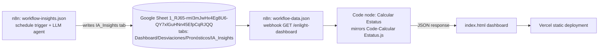

# CLAUDE.md — Enlight One Dashboard

## Purpose
Interactive project dashboard for monitoring photovoltaic and BESS projects across all phases and PMs. Consumes data from a Google Sheet ("Enlight One Database_Esquema 2026") via an n8n webhook and deploys to Vercel as a static site. Companion tool to the Enlight One PM milestone tracker system.

## Status
- **Phase:** Active Development
- **Last audited:** 2026-07-08
- **Last modified:** 2026-07-08
- **Owner:** Emiliano / Enlight TECH

## Architecture

- `workflow-insights.json` runs on a schedule, reads Dashboard/Desviaciones, calls a Gemini LLM agent (`@n8n/n8n-nodes-langchain`), and writes rows back into the `IA_Insights` tab. `workfloe-data.json` later reads that tab and returns the latest-timestamp batch to the dashboard as `insightsIA`.
- The `Pronósticos` tab implements a forecast cascade (Real > Modificada > Tentativa > Prevista per hito) and stamps unfinished hitos with `Fecha Real` = today, which is why the deviations logic must split "closed" vs "open (in-progress)" measurements (see Key Technical Decisions).

## Files & Responsibilities
| File | Type | Purpose |
|------|------|---------|
| `index.html` | HTML | Main, actively-deployed dashboard — dark/light theme, Chart.js visualizations, multi-tab, Gantt view, filters |
| `Dashboard Enlight.dc.html` | HTML | Separate/older version (579 lines vs 2,594 in index.html — **not** a near-duplicate; diverged significantly). Deployment target unclear. |
| `Code-Calcular Estatus.js` | n8n Code node JS | Source-of-truth copy of the "Calcular Estatus" Code node. **Verified byte-identical** (CRLF-normalized) to the `jsCode` embedded in `workfloe-data.json` as of 2026-07-08 — keep both in sync manually whenever one is edited; there is no build step that syncs them automatically. |
| `workfloe-data.json` | n8n workflow | Main data-fetch flow: Webhook → 3x Google Sheets reads (Dashboard, Desviaciones, Pronósticos) + 1 metadata read (Fecha pronóstico) + IA_Insights read → Merge → Code (Calcular Estatus) → Respond to Webhook. Filename has a typo (missing "r"). |
| `workflow-insights.json` | n8n workflow | Schedule-triggered flow: reads Dashboard + Desviaciones → LangChain Agent (Gemini) → writes to IA_Insights tab. |
| `vercel.json` | Config | Minimal Vercel config (`{"framework": null}`) — static file serving, no build step |
| `README.md` | Docs | Setup instructions; **out of date** — describes a `public/index.html` + `n8n/workflow.json` folder structure that does not exist in this repo (files live at repo root) |
| `logo-enlight.png` / `logo-enlight-dark.svg` | Assets | Dashboard branding |

## External Dependencies
| System | How connected | Credential location |
|--------|---------------|---------------------|
| Google Sheets ("Enlight One Database_Esquema 2026", ID `1_RJ65-rmI3mJwHx4Eg8U6-QY7xlGuHNn45EfpCqRJQQ`) | n8n Google Sheets nodes — tabs: Dashboard (gid=0), Desviaciones (gid=1915245543), Pronósticos (gid=1857694411, data range A2:BB, forecast cut-date in row 1 read by the 'Fecha pronóstico' node), IA_Insights (gid=63866189) | n8n credentials store |
| n8n webhook (`egenlight.app.n8n.cloud/webhook/enlight-dashboard`) | Browser `fetch()` from `index.html` (GET, no auth) | n8n instance (self-hosted) |
| Gemini LLM (via LangChain node) | `workflow-insights.json` agent node | n8n credentials store |
| Vercel | Static deployment of `index.html` | Vercel account |

## Key Technical Decisions (ADRs)
1. **SPI (Schedule Performance Index)** = `aTiempo / (aTiempo + conRetraso + atrasados)`, rounded to 2 decimals (see `calcSPI()` in `index.html`). Color-coded: ≥0.90 accent/green, ≥0.70 warn/yellow, <0.70 danger/red.
2. **13 hitos tracked per project** — confirmed: the `HITOS` array in `Code-Calcular Estatus.js` has exactly 13 entries (Entrega Ingenierías → Interconexión).
3. **Estatus logic**: reference date = Tentativa if present, else Prevista. Without a "Fecha modificada" the hito is `Atrasado` (past reference) or `Pendiente` (future reference); with one it's `Cumplido a tiempo` or `Cumplido con retraso`. The "real" columns (`Fecha <hito>`) in Dashboard are **computed cascade values, not PM input** and are intentionally not used for status — only `Fecha modificada <hito>` reflects genuine PM entry.
4. **Open vs closed deviations (added 2026-07-08)**: each row in `desviaciones` now carries a `cerrada` flag (true if the hito already has a `Fecha modificada` in Dashboard). Because the deviation sheet's cascade writes `Fecha Real` = today for unfinished hitos, an "open" deviation's day-count grows daily and would corrupt averages if mixed with real (closed) deviations. `promedioDesviacion` / `promedioDesviacionNeta` now aggregate **closed only**; a new `promedioDesviacionAbierta` output aggregates **open** deviations (measured against the original Prevista, a moving count vs today).
5. `numOrNull()` helper distinguishes a genuine blank/no-data value from a legitimate `0` in deviation fields (previous `parseFloat(x) || 0` pattern silently conflated the two).
6. Header-typo tolerance is handled in code rather than by editing the live sheet, to avoid breaking other consumers of the sheet:
   - `% ApbCliente` (sheet is missing a space) — read with a no-space fallback key.
   - `Fecha modificada Pase a Pase a Gestión` — the sheet header itself has this duplicated "Pase a" typo; code reads it and also tries `Fecha modificada Pase a Gestión` (`modificadaAlt`) so nothing breaks if the header is ever corrected.
   - Desviaciones hito name for "Pase a Servicios" corrected to `'Pase a Servicios'` (previously mismatched as `'Fecha Pase a Servicios/liberación de sitio'`, which never matched anything in the Desviaciones sheet's `Hito` column).
   - Gantt plan-date map: `'Apb Cliente'` now reads `'Fecha tentativa ingeniería aprobada por el cliente'` (the previous mapped column name did not exist in the sheet, so plan bars for the Ingeniería phase were rendering blank).
7. **Client-side re-aggregation of deviations**: `index.html`'s `aggDesvPorHito()` (added 2026-07-08) recomputes the deviation charts ("Desviación neta promedio por hito", "Desviación en curso por hito") and the "Desv. neta promedio" KPI directly from `rawData.desviaciones`, filtered by whatever filters are currently active. This makes **all charts on all tabs filter-reactive**. Falls back to the server pre-aggregates when per-row detail or the `cerrada` flag is missing (demo mode, or an older cached API payload without the field).
8. Demo mode flag (`DEMO_MODE` constant, currently `false`) and `API_URL` constant (currently `https://egenlight.app.n8n.cloud/webhook/enlight-dashboard`) are both hardcoded at the top of the `<script>` block in `index.html` — README instructs editing them directly rather than using an env var.

## Design System Compliance
- Alexandria used for display/headings, but body font is **Roboto**, loaded from Google Fonts CDN. Roboto is not an Enlight DS font; Albert Sans should replace it, and fonts should be self-hosted per the DS spec.
- Colors match brand palette (`--c1:#293C47`, `--c2:#00AA85`, `--c3:#3D7D80`, `--c4:#121926`, `--c5:#828080` = Acero/Jade/Cerceta/Marino/Gris) but are hardcoded hex as local CSS vars, not imported from `colors_and_type.css`. Several hex literals are also inlined directly in markup/JS (e.g. Gantt legend spans, `ADO_COLORS`), bypassing the var layer.
- Jade (`--accent`) correctly used as the single primary accent (SPI "good", active tab, KPI highlight).
- Dark theme uses near-black/Marino backgrounds consistent with DS intent; Gantt tooltips have explicit light-theme overrides (dark box with light text, fixed 2026-07-08).

## Known Issues / Tech Debt
1. **Font violation**: Roboto instead of Albert Sans for body/UI text; fonts pulled from Google Fonts CDN instead of self-hosted.
2. **No design-token import**: colors re-declared as local hex CSS vars instead of importing `colors_and_type.css`; some hex inlined outside the var layer.
3. **Typo in workflow filename**: `workfloe-data.json` (missing "r") — cosmetic but can confuse imports/scripts.
4. **Two divergent HTML files**: `index.html` (2,594 lines, actively developed) vs `Dashboard Enlight.dc.html` (579 lines, diverged) — no marker of which is deployed. Needs consolidation or an explicit "deprecated" marker.
5. **No Error Trigger node** in either n8n workflow (violates the project convention of Error Trigger + fallback branch). If a Sheets read or the LLM call fails, the webhook returns a raw n8n error or times out silently.
6. **Public, unauthenticated webhook**: `allowedOrigins: '*'`, no API key, `Access-Control-Allow-Origin: *`. Payload includes internal fields (`comentariosRetraso`, `areaResponsable`) — effectively public exposure of internal project commentary to anyone with the URL.
7. **README is stale**: describes a `public/` + `n8n/` folder layout that doesn't match the flat repo structure.
8. **Hardcoded `API_URL` / `DEMO_MODE`** in `index.html` — recurring risk of shipping the wrong URL or leaving demo mode on.
9. **Pronósticos "Estatus" cascade needs verification**: sample data shows `Cumplido` on future-dated hitos. The Gantt code branches on `Cumplido futuro`/`Pronóstico` to render forecast phases, but if the sheet's cascade only ever emits plain `Cumplido`, forecast phases render as fully completed. Verify against live sheet data (sheet-formula fix if confirmed).
10. **Manual sync risk**: `Code-Calcular Estatus.js` ↔ the Code node in `workfloe-data.json` are synced by hand (verified identical 2026-07-08). Local files are NOT live: code changes must be pasted into the n8n Code node, and `index.html` changes redeployed to Vercel.

## Open Questions
- Which HTML file is deployed to Vercel — and is `Dashboard Enlight.dc.html` dead code that should be deleted?
- Should the webhook be locked down (API key / origin allowlist) given it exposes internal delay commentary publicly?
- Does the Pronósticos cascade genuinely emit distinct `Cumplido futuro`/`Pronóstico` values, or can a future date be mislabeled `Cumplido`? Needs verification against live sheet data.
- Migrate to self-hosted Alexandria/Albert Sans and the shared `colors_and_type.css` token file, or accept the current hardcoded-but-matching palette?

## Agent Routing
- n8n tasks -> @agent-n8n
- Frontend tasks -> @agent-html
- NetSuite tasks -> @agent-netsuite
